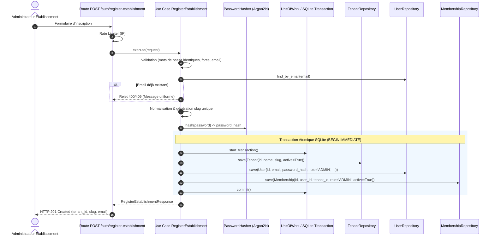
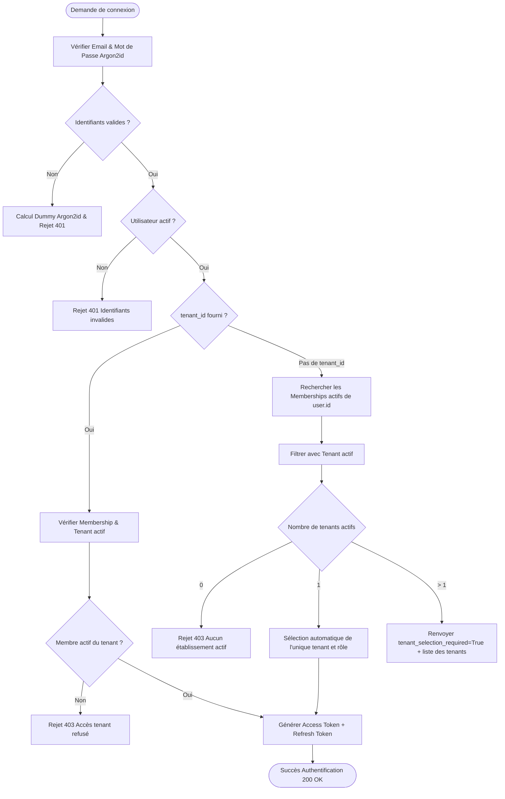

# EduNova V1.2 — Plan Technique d'Implémentation : Self-Service Registration & Tenant Provisioning

**Date :** 8 novembre 2026  
**Auteur :** Antigravity (Advanced Agentic Coding)  
**Référence :** `docs/v1.2/SELF_SERVICE_REGISTRATION_AUDIT.md`  
**Statut :** PROPOSITION EN ATTENTE DE VALIDATION

---

## 1. Principes Directeurs et Architecture

Ce plan définit l'ingénierie nécessaire pour déployer l'inscription autonome (*Self-Service Registration*) et le provisionnement multi-tenant dans EduNova sans rupture de continuité de service ni compromis sur la sécurité.

### Piliers Techniques :
1. **Clean Architecture & DDD :** Respect de l'étanchéité des couches (Domaine -> Application -> Infrastructure -> Présentation).
2. **Atomicité Transactionnelle :** Inscription en tout-ou-rien. La création du Tenant, de l'Utilisateur et du Membership d'administration s'exécute dans une seule transaction SQLite.
3. **Sécurité & AUTH-HARDENING :** Préservation intégrale du rate limiting IP/compte, du hachage Argon2id, des protections anti-timing et anti-énumération de la Phase 1.
4. **Fluidité UX & Rétrocompatibilité :** Résolution automatique du tenant au login pour les utilisateurs mono-établissement, tout en maintenant 100 % de compatibilité avec les clients passant un `tenant_id` explicite.

---

## 2. Modèle et Couche Application

### 2.1. DTOs d'Inscription d'Établissement

```python
# src/identity/application/dto/register_establishment_request.py
@dataclass(frozen=True)
class RegisterEstablishmentRequest:
    school_name: str
    admin_name: str
    email: str
    password: str
    password_confirmation: str
    phone: str | None = None
    city: str | None = None
    country: str | None = "RDC"

# src/identity/application/dto/register_establishment_response.py
@dataclass(frozen=True)
class RegisterEstablishmentResponse:
    tenant_id: UUID
    tenant_name: str
    tenant_slug: str
    user_id: UUID
    admin_name: str
    email: str
    role: str  # "ADMIN"
    created_at: str
```

### 2.2. Algorithme de Génération de Slug et Déduplication

Pour convertir un nom d'école en slug URL-safe :
1. Normalisation Unicode (NFKD), suppression des accents.
2. Remplacement des caractères non alphanumériques par des tirets `-`.
3. Suppression des tirets consécutifs et mise en minuscules.
4. Vérification d'unicité via `tenant_repository.find_by_slug(slug)`.
5. Si le slug existe déjà : concaténer un suffixe hexadécimal déterministe ou aléatoire court (ex: `lycee-de-kinshasa-4f2a`).

### 2.3. Use Case : `RegisterEstablishment`



---

## 3. Évolution des Repositories et de la Persistance

### 3.1. Extension de `TenantRepository`

```python
# src/tenancy/application/interfaces/tenant_repository.py
class TenantRepository(ABC):
    @abstractmethod
    def save(self, tenant: Tenant) -> None:
        """Persiste un nouveau tenant ou met à jour un tenant existant."""
        raise NotImplementedError

    @abstractmethod
    def find_by_id(self, tenant_id: UUID) -> Tenant | None:
        raise NotImplementedError

    @abstractmethod
    def find_by_slug(self, slug: str) -> Tenant | None:
        """Recherche un tenant par son slug textuel unique."""
        raise NotImplementedError
```

### 3.2. Implémentation `SQLiteTenantRepository`

- Ajouter la méthode `save(self, tenant: Tenant, connection: Connection | None = None)` :
  ```sql
  INSERT INTO tenants (id, name, slug, active)
  VALUES (?, ?, ?, ?)
  ON CONFLICT(id) DO UPDATE SET
      name = excluded.name,
      slug = excluded.slug,
      active = excluded.active;
  ```
- Ajouter la méthode `find_by_slug(self, slug: str) -> Tenant | None` :
  ```sql
  SELECT id, name, slug, active FROM tenants WHERE slug = ?;
  ```

### 3.3. Gestion Transactionnelle Atomique (Unit of Work)

Pour garantir qu'aucun enregistrement partiel n'ait lieu en cas d'erreur SQLite :
- Utiliser le gestionnaire de contexte transactionnel natif de Python SQLite :
  ```python
  with database.connect() as connection:
      with connection:  # Déclenche BEGIN IMMEDIATE et gère COMMIT / ROLLBACK
          tenant_repo.save_in_tx(tenant, connection)
          user_repo.save_in_tx(user, connection)
          membership_repo.save_in_tx(membership, connection)
  ```
- Si une exception est levée (par exemple contrainte d'intégrité ou panne), SQLite effectue un `ROLLBACK` automatique.

---

## 4. Évolution de l'Authentification et du Login

### 4.1. `LoginUserRequest` : Rendre `tenant_id` Optionnel

Le DTO d'application et le schéma Pydantic sont assouplis :
```python
# src/identity/application/dto/login_user_request.py
@dataclass(frozen=True)
class LoginUserRequest:
    email: str
    password: str
    tenant_id: UUID | None = None

# src/presentation/api/schemas/login_user_request.py
class LoginUserRequest(BaseModel):
    model_config = ConfigDict(extra="forbid")
    email: str = Field(min_length=3)
    password: str = Field(min_length=1)
    tenant_id: UUID | None = None
```

### 4.2. Algorithme de Résolution de Tenant dans `LoginUser`



### 4.3. Réponse Enrichie `LoginUserResponse`

```python
# src/presentation/api/schemas/login_user_response.py
class AvailableTenantDto(BaseModel):
    tenant_id: UUID
    tenant_name: str
    tenant_slug: str
    role: str

class LoginUserResponse(BaseModel):
    authenticated: bool
    two_factor_required: bool
    two_factor_token: str | None = None
    access_token: str | None = None
    refresh_token: str | None = None
    email: str | None = None
    tenant_selection_required: bool = False
    available_tenants: list[AvailableTenantDto] = []
```

---

## 5. Contrats d'Interface API

### 5.1. Endpoint `POST /auth/register-establishment`

- **URL :** `/api/v1/auth/register-establishment`
- **Méthode :** `POST`
- **Authentification :** Publique (non authentifiée)
- **Rate Limit :** 5 requêtes par fenêtre de 15 minutes par IP (`register_establishment:ip:{ip}`)
- **Corps de la requête (JSON) :**
  ```json
  {
    "school_name": "Complexe Scolaire Cardinal Malula",
    "admin_name": "Dieudonné Mwamba",
    "email": "direction@cs-malula.cd",
    "password": "PasswordStrong123!",
    "password_confirmation": "PasswordStrong123!",
    "phone": "+243810000001",
    "city": "Kinshasa",
    "country": "RDC"
  }
  ```
- **Réponse HTTP 201 Created :**
  ```json
  {
    "tenant_id": "8a3e7b1a-9c42-4f12-a1e5-829d8b13c740",
    "tenant_name": "Complexe Scolaire Cardinal Malula",
    "tenant_slug": "complexe-scolaire-cardinal-malula",
    "user_id": "b2f15a63-e38a-4d3e-96b0-7db073bf2118",
    "admin_name": "Dieudonné Mwamba",
    "email": "direction@cs-malula.cd",
    "role": "ADMIN",
    "created_at": "2026-11-08T09:30:00Z"
  }
  ```
- **Réponses d'Erreur :**
  - `400 Bad Request` : Mots de passe non concordants, champs obligatoires manquants, mot de passe trop faible.
  - `409 Conflict` : Adresse email déjà utilisée.
  - `429 Too Many Requests` : Rate limit dépassé (avec en-tête `Retry-After`).

---

## 6. Architecture Frontend (React / TypeScript)

### 6.1. Nouvelle Page `RegisterEstablishmentPage.tsx`
- **Emplacement :** `frontend/src/features/auth/pages/RegisterEstablishmentPage.tsx`
- **Styles :** `RegisterEstablishmentPage.css`
- **Composants :**
  - En-tête avec logo EduNova et titre *"Inscrire mon établissement"*.
  - Formulaire structuré en sections claires :
    1. *Informations de l'établissement* (Nom de l'école, ville, téléphone).
    2. *Compte Administrateur* (Nom complet, email professionnel, mot de passe, confirmation).
  - Indicateur de robustesse du mot de passe en temps réel (longueur, majuscule, chiffre, caractère spécial).
  - Affichage des erreurs de validation sous les champs (`touched` state).
  - Bouton de soumission avec état de chargement (*"Création de votre espace en cours..."*).
  - Écran de succès post-création :
    - Récapitulatif avec badge vert de validation.
    - Affichage de l'identifiant d'établissement (`tenant_id`) et du lien d'accès (`slug`) avec bouton "Copier".
    - Bouton principal : *"Accéder à mon tableau de bord"* (redirection vers `/login` avec email pré-rempli).

### 6.2. Évolution de `LoginPage.tsx`
- Rendre le champ `Identifiant d'établissement (Tenant ID)` repliable ou facultatif avec mention *"Optionnel si vous n'avez qu'un seul établissement"*.
- En cas de réponse `tenant_selection_required: true`, afficher un sélecteur d'établissement interactif plutôt qu'une erreur brute.
- Ajouter un lien visible sous le formulaire de connexion : *"Vous êtes un nouvel établissement ? Créez votre espace EduNova"*.

### 6.3. Déclaration du Routage
- Mettre à jour `frontend/src/app/router/routes.tsx` :
  ```tsx
  { path: '/register-establishment', element: <RegisterEstablishmentPage /> },
  ```

---

## 7. Plan de Validation et 10 Scénarios de Test

Les 10 tests obligatoires couvrent l'intégralité du cycle fonctionnel, transactionnel et sécuritaire :

| N° | Scénario de Test | Type | Résultat Attendu |
|---|---|---|---|
| **1** | Inscription nominale complète | Unitaire / Intégration | Tenant, User et Membership ADMIN créés avec succès ; retour HTTP 201. |
| **2** | Tentative avec email déjà existant | Sécurité / Unitaire | Rejet propre (409 Conflict ou 400), aucun duplicata en base, timing uniforme. |
| **3** | Collision de nom d'établissement (slugs identiques) | Domaine / Intégration | Résolution automatique du slug par suffixe unique (ex: `-2` ou hash court) sans échec. |
| **4** | Rollback transactionnel sur erreur Membership | Intégration / DB | Si l'insertion de Membership échoue, le Tenant et le User sont annulés (0 orphelin en base). |
| **5** | Connexion sans `tenant_id` (utilisateur mono-tenant) | Intégration / Auth | Authentification réussie, tenant résolu automatiquement, tokens JWT valides. |
| **6** | Connexion sans `tenant_id` (utilisateur multi-tenant) | Intégration / Auth | Retourne `tenant_selection_required=True` avec la liste des tenants autorisés. |
| **7** | Connexion avec `tenant_id` explicite | Non-régression | Rétrocompatibilité totale avec le flux existant (access token avec le tenant ciblé). |
| **8** | Tentative d'accès cross-tenant non autorisé | Sécurité / DDD | Rejet immédiat `HTTP 403 Forbidden` (`Acces tenant refuse.`). |
| **9** | Rate limiting sur l'inscription d'établissement | Sécurité / HTTP | Blocage au 6ᵉ appel avec code `HTTP 429` et en-tête `Retry-After`. |
| **10** | Intégrité des contraintes SQLite | Persistance / DB | Vérification des clés étrangères (`PRAGMA foreign_keys = ON`), unicité et cascade. |

---

## 8. Découpage en Étapes d'Exécution

Une fois ce plan validé par l'utilisateur, l'implémentation sera conduite selon l'ordre strict suivant :

1. **Étape 1 : Persistance et Interfaces Tenancy**
   - Compléter `TenantRepository` et `SQLiteTenantRepository` (`save`, `find_by_slug`).
   - Mettre en place le support transactionnel atomique.
2. **Étape 2 : Use Case Applicatif `RegisterEstablishment`**
   - Implémenter les DTOs, la génération de slug avec déduplication, et le use case.
   - Écrire la suite de tests unitaires (scénarios 1, 2, 3, 4).
3. **Étape 3 : Évolution de `LoginUser`**
   - Rendre `tenant_id` optionnel, implémenter la résolution mono-tenant et multi-tenant.
   - Écrire les tests unitaires (scénarios 5, 6, 7, 8).
4. **Étape 4 : Routes API et Schemas Pydantic**
   - Créer `POST /auth/register-establishment` avec rate limiting.
   - Mettre à jour `POST /auth/login` et les dépendances du conteneur.
   - Écrire les tests d'intégration HTTP (scénarios 9, 10).
5. **Étape 5 : Frontend React & Router**
   - Implémenter `RegisterEstablishmentPage.tsx` et son CSS.
   - Adapter `LoginPage.tsx` (tenant optionnel et lien vers inscription).
   - Déclarer la route dans `routes.tsx` et valider les tests frontend (`npm test` / `vitest`).
6. **Étape 6 : Validation Globale et Rapport**
   - Exécution de l'intégralité de la suite de tests backend (`pytest`) et frontend.
   - Vérification de qualité (`ruff`, `mypy`).
   - Rédaction du rapport de livraison `docs/v1.2/SELF_SERVICE_REGISTRATION_RAPPORT.md`.
